<div align="center">

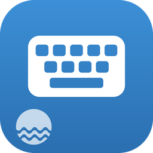

<h1>三溪输入法 · 源代码</h1>

<h3>越用越懂你，不会越用越傻。</h3>

<p>Android 离线输入法：全拼、双拼、九宫格、英文、按住说话的语音输入，学习规则自己定，输入的内容只留在手机里。基于开源的<a href="https://github.com/gurecn/YuyanIme">语燕输入法</a>修改。</p>


[它做什么](#它做什么) · [现状](#现状) · [架构](#架构) · [代码地图](#代码地图) · [开发](#开发) · [发布](#发布一个新版本) · [许可](#许可) · [官网](https://www.threebrook.com)

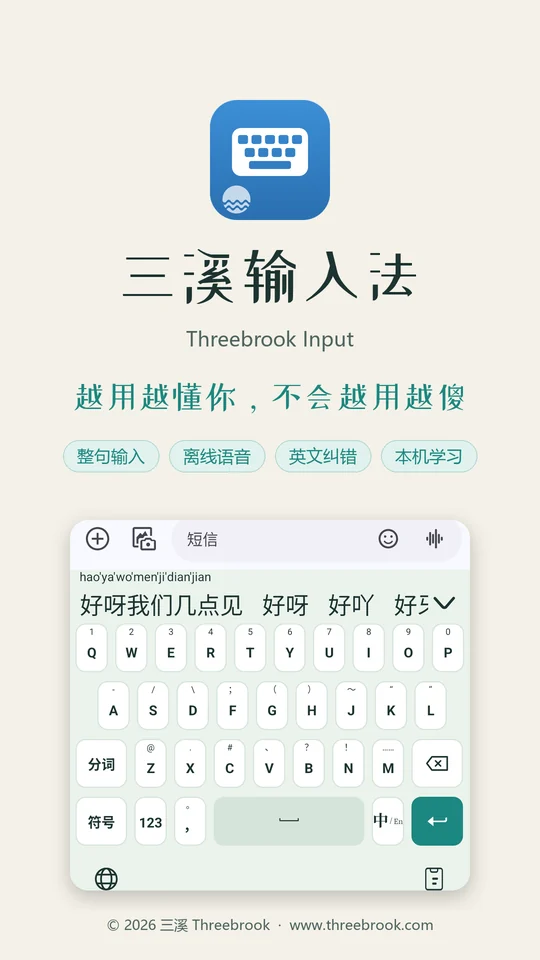

</div>

> [!IMPORTANT]
> **这是三溪输入法的源代码仓库。** 三溪新增和修改的部分版权归三溪 Threebrook（珠海三溪科技有限公司）所有；源自语燕输入法的部分沿用其 BSD 3-Clause 许可，详见[许可](#许可)。安装包在本仓库的 [Releases](https://github.com/ThreeBrook/Threebrook-IME-source/releases)。

## 它做什么

商业输入法用久了，误选一次的词就霸占第一位，候选栏塞满表情和广告。三溪输入法只做输入：

| ⌨️ 多种输入方式 | 🧠 越用越懂你 | 🎙️ 按住说话 |
| --- | --- | --- |
| 全拼、双拼（小鹤、自然码等）、九宫格、英文、手写、笔画，整句输入。 | 一个词用过约 3 次才排到第一，30 天不用慢慢退后；选错了紧接着删掉就不算。学到的词可以在“我的词库”里查看、删除。 | 长按空格说话、松开出字，上滑取消。SenseVoice 模型在手机上识别，录音不保存、不上传。 |

另外：英文拼错也能给出正确的词（`teh` → `the`）；时间、日期、表情不抢前排候选；密码框里输入的内容不学习、不进剪贴板记录；浅色 / 深色跟随系统。

<table>
<tr>
<td width="25%">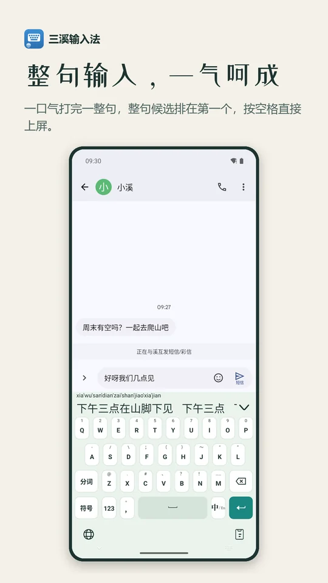</td>
<td width="25%">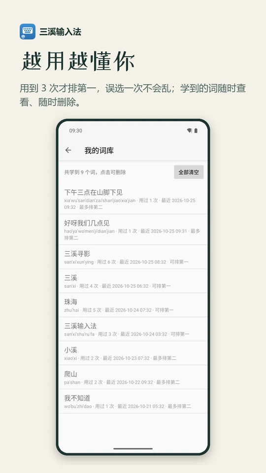</td>
<td width="25%">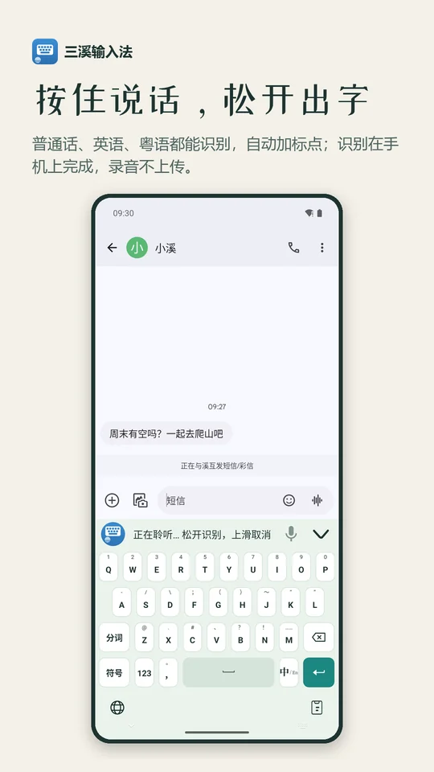</td>
<td width="25%">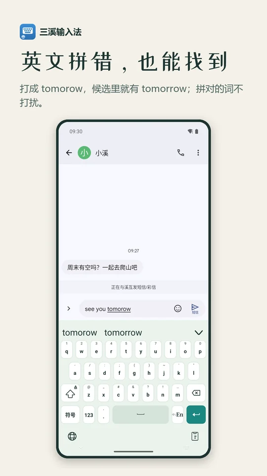</td>
</tr>
<tr>
<td width="25%">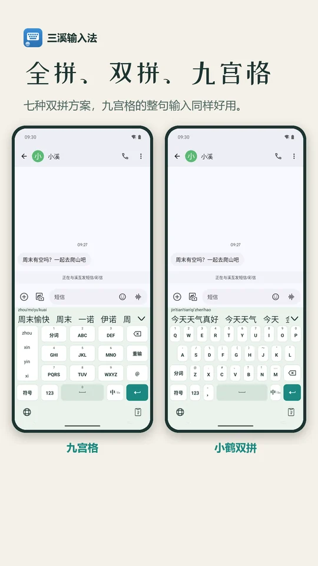</td>
<td width="25%">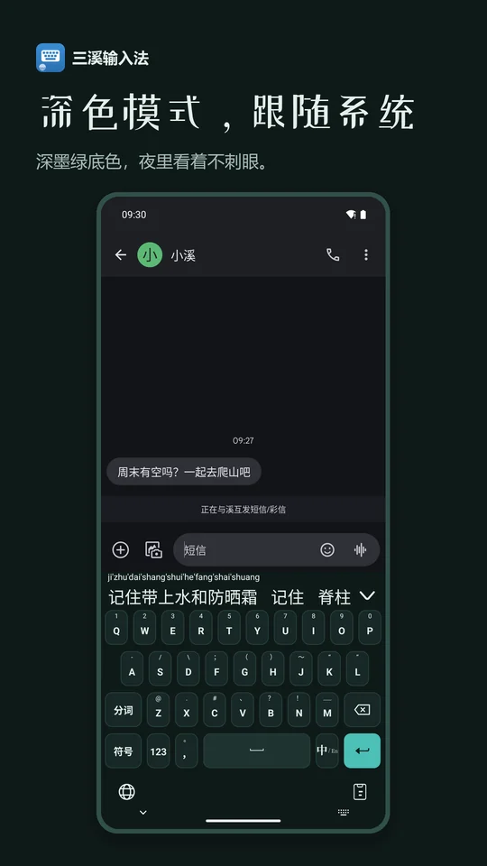</td>
<td width="25%">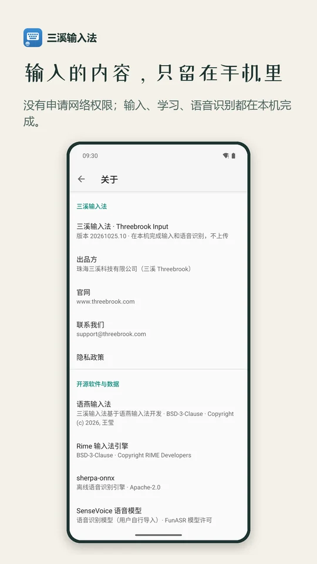</td>
<td width="25%"></td>
</tr>
</table>

> 这些图在 Android 15 模拟器上截取，聊天内容和部分词库条目是演示数据。

## 现状

<table>
<tr><th>项目</th><th>状态</th></tr>
<tr><td><b>Android</b></td><td>✅ 正式版已能编译（arm64，R8 混淆，自有签名）：全拼 / 双拼 / 九宫格 / 英文、自定义学习规则和“我的词库”、英文纠错、离线语音输入（App 内导入模型）、密码框不学习、三溪键盘主题和图标、关于页与协议全文。在模拟器上测过</td></tr>
<tr><td>真机测试</td><td>⏳ 还没在真手机上测：打字手感、真实语音识别、内存占用</td></tr>
<tr><td>手写</td><td>⚠️ 手写识别沿用语燕带的预编译库（含 <code>libSogouShell.so</code>），授权来源不明，公开分发前要确认</td></tr>
<tr><td>协议</td><td>⚠️ 隐私政策、软件许可协议已起草并内置在 App 里，还没经过法务审核</td></tr>
<tr><td>iOS</td><td>✖ 暂不做</td></tr>
</table>

**价格**：免费。**权限**：只申请振动和麦克风（按住说话时才用），没有申请网络权限。

## 架构

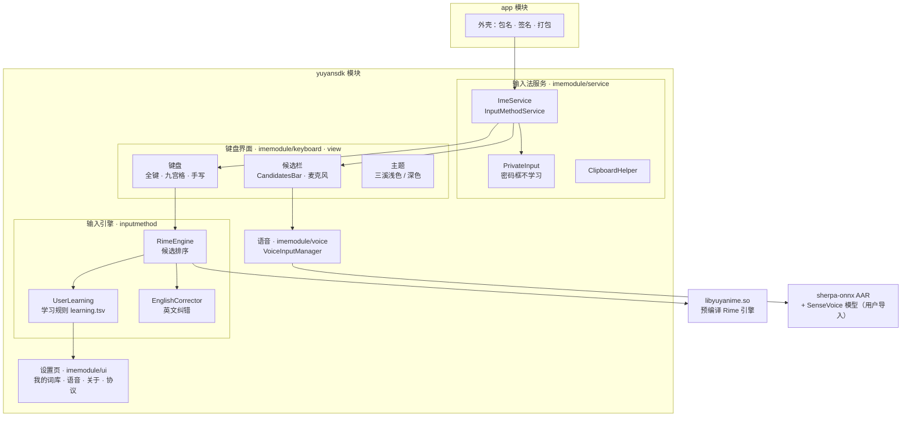

### 一次拼音输入

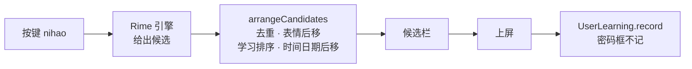

## 代码地图

```
app/                          外壳模块：包名、签名、打包，APK 名 threebrookIme_<日期小时>_<debug|release>.apk
yuyansdk/                     输入法本体（原语燕的 SDK 子模块，已并入本仓库）
  src/main/java/com/yuyan/
    inputmethod/
      RimeEngine.kt           候选排序 arrangeCandidates、上屏、学习键
      UserLearning.kt         学习规则：门槛、遗忘、撤销，关掉 Rime 自带学习
      EnglishCorrector.kt     英文纠错：字典树 + 加权编辑距离
      core/Rime.kt            引擎 JNI 接口（签名不能改，对应预编译 .so）
    imemodule/
      service/                ImeService、InputDispatcher、PrivateInput（密码框）、ClipboardHelper
      keyboard/ view/         键盘（长按空格语音输入）、候选栏
      voice/                  按住说话：录音、静音判断、调用 sherpa-onnx
      data/theme/             主题：ThreebrookLight / ThreebrookDark 为默认
      ui/fragment/            设置页：我的词库、语音识别、关于、协议（WebView）
  src/main/assets/
    rime/                     Rime 方案和词库（编译好的 .bin）
    english/                  英文词频表（CC BY-SA）
    legal/                    协议页面（由 tools/gen_legal_html.py 生成，不要手改）
  libs/                       预编译 libyuyanime.so、手写库；sherpa-onnx/ 是包 AAR 的 Gradle 模块
  docs/legal/                 隐私政策、软件许可协议、开源许可的 Markdown 原文
  tools/
    gen_icons.py              生成应用图标（矢量，晴蓝 #2F7FC1）
    gen_legal_html.py         docs/legal/*.md → assets/legal/*.html
doc/                          学习规则、语音输入、英文纠错的说明；images/ 是本 README 的配图
```

> [!NOTE]
> 不在仓库里的：签名文件 `keystore/threebrook.jks` 和 `keystore/keystore.properties`（单独备份，丢了就没法给已安装的用户发更新）、语音模型（约 230 MB，用户在 App 里导入）、三溪外观规范等设计资料、宣传素材原图、`build/`。

## 开发

需要 **JDK 17**（Android Studio 自带的 Java 25 跑不了 Gradle 8.9）和 Android SDK 35。项目路径里有中文时要加 `-Pandroid.overridePathCheck=true`。

```bash
./gradlew assembleOfflineDebug -Pandroid.overridePathCheck=true     # 调试版：arm64 + x86_64（模拟器用），包名 com.yuyan.pinyin.offline.debug
./gradlew assembleOfflineRelease -Pandroid.overridePathCheck=true   # 正式版：arm64，R8 混淆，包名 com.yuyan.pinyin.offline.release
python yuyansdk/tools/gen_legal_html.py                             # 改了 docs/legal 后重新生成协议页面
```

产物在 `app/build/outputs/apk/offline/{debug,release}/`。

- **模拟器**：x86_64 镜像会报告有物理键盘，要在设置里打开“物理键盘显示软键盘”；语音识别在 ARM 转译下会崩，所以调试版额外打了 x86_64。
- **语音模型**：用 `sherpa-onnx-sense-voice-zh-en-ja-ko-yue-int8-2024-07-17`（2025-09-09 版实测更差）。设置 → 语音输入 → 导入，详见 [`doc/语音输入说明.md`](doc/语音输入说明.md)。
- **学习规则**的参数和原理见 [`doc/学习规则说明.md`](doc/学习规则说明.md)，英文纠错见 [`doc/英文纠错说明.md`](doc/英文纠错说明.md)。
- **sherpa-onnx 的 R8 规则不能删**：`-keep class com.k2fsa.sherpa.onnx.** { *; }`，JNI 按名字读字段。

## 发布一个新版本

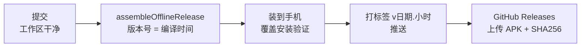

1. 改动全部提交，确认 `git status` 干净。
2. 编译正式版。版本号自动取编译时间（`versionName` 如 `20261025.16`，`versionCode` 如 `2026102516`），只会变大，覆盖安装不会被拒。
3. 在手机上覆盖安装旧版，确认学到的词、设置都还在。
4. 打标签 `v<versionName>`，推送标签，在 Releases 上传 APK 和它的 SHA256。

## 许可

- 三溪输入法基于 [语燕输入法](https://github.com/gurecn/YuyanIme)（BSD 3-Clause，Copyright (c) 2026 王莹），原许可见 [`LICENSE`](LICENSE) 和 [`yuyansdk/LICENSE`](yuyansdk/LICENSE)，分发时必须保留。
- 三溪新增和修改的代码、图标、文案版权归三溪 Threebrook（珠海三溪科技有限公司）所有。
- 其他开源组件（Rime、sherpa-onnx、SenseVoice、英文词频表等）的许可见 [`yuyansdk/docs/legal/开源许可.md`](yuyansdk/docs/legal/开源许可.md)。
- 用户协议：[隐私政策](yuyansdk/docs/legal/三溪输入法-隐私政策.md) · [软件许可协议](yuyansdk/docs/legal/三溪输入法-软件许可协议.md)。

## 约束

> [!WARNING]
> 改代码前必须遵守：
> 1. **不申请网络权限**：不联网、没有统计、没有云同步；学到的词和设置只在手机里。
> 2. **密码框不学习**：`PrivateInput.active` 时不记录学习、不进剪贴板记录。
> 3. **包名不改**：`com.yuyan.pinyin.offline.release`，改了等于新 App，已装用户收不到更新、学习记录也带不过去。
> 4. **签名文件不进仓库**，换签名同样会让已装用户无法覆盖安装。
> 5. **`core/Rime.kt` 的 JNI 签名不改**，它对应预编译的 `libyuyanime.so`，没有源码可以重编。
> 6. 键盘颜色按三溪外观规范（产品色晴蓝 `#2F7FC1`）。

## 协作约定

- 注释、提交说明用中文；注释密度和命名跟周围代码一致。
- 只在需要时提交；`build/`、签名文件、语音模型不进仓库。

---

<div align="center">

<picture>
  <source media="(prefers-color-scheme: dark)" srcset="https://threebrook.com/lockup-dark.svg">
  
</picture>

<sub>© 2026 三溪 Threebrook · 珠海三溪科技有限公司 · support@threebrook.com<br>基于语燕输入法（BSD 3-Clause）</sub>

</div>
